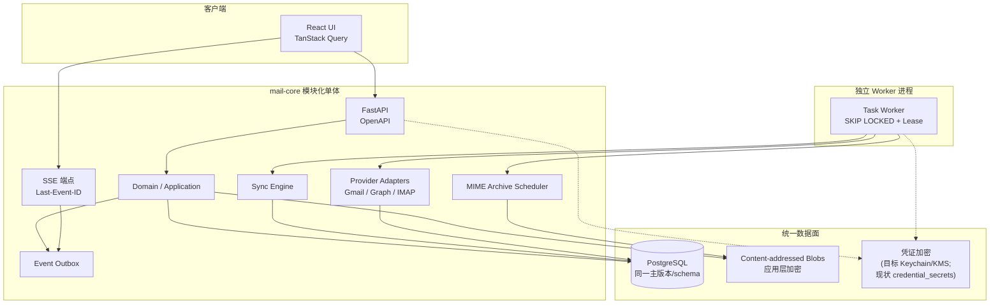
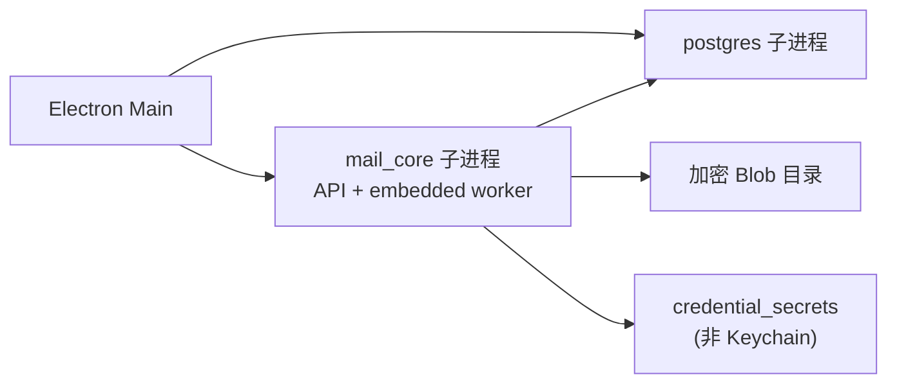
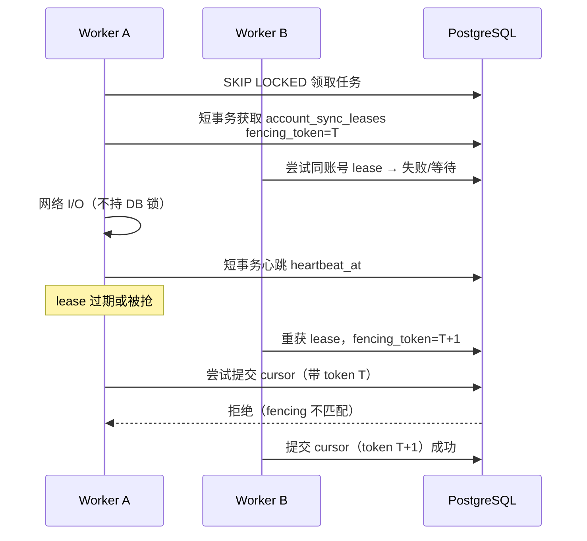
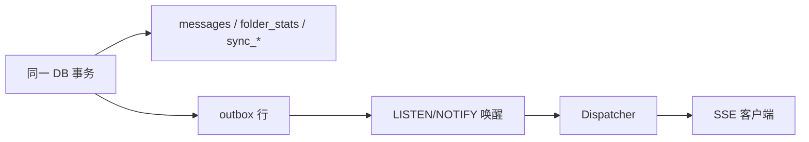

> [!NOTE]
> **过时 / 已取代 — 状态注记（2026-10-27 补）**
> 本文档定稿于 2026-10-21，原「已定稿，供实现」状态已失效：本文已被 [docs/blueprint/architecture.md](../../blueprint/architecture.md) 与 `docs/specs/` 各生效 spec 取代，仅作历史归档。文中 Gmail API / Google OAuth 相关章节已失效（该路径已于 2026-10-26 整体下线，现行 Google 接入见 [docs/specs/account_connection.md](../../specs/account_connection.md) 的 2026-10-26 节）；文中指向同目录下已不存在文件的相对链接为历史残留，不代表现行文档结构。

# kkmail 邮件内核重构技术方案

## 文档信息（状态：已定稿供实现；范围：不含发送/联系人/通知）

| 项 | 内容 |
|---|---|
| 文档状态 | **已定稿，供实现** |
| 受众 | 产品负责人、后续实现者 |
| 产品 | kkmail 邮件内核（mail-core）重写 |
| 范围边界 | **本阶段不含**：发送（compose/send）、联系人、系统通知推送。**永久不做**：浏览器扩展（Chrome/Firefox 等）— cancelled / wontfix，永不交付 |
| 数据策略 | 旧邮件缓存**不作为真相源**；新建邮件库（greenfield）；账号/设置/凭证仅做高层迁移 |
| 架构形态 | 模块化单体（modular monolith）+ 独立 Worker；统一邮件模型 |
| 修订原则 | 保留原提案全部支柱；仅吸收已确认的六项修订，不重新争论 FastAPI vs Flask，不放弃 Gmail |

---

## 1. 目标与原则

### 1.1 目标

将 kkmail 邮件内核重建为**本地权威、协议隔离、可正确同步**的模块化单体系统：

1. **本地为唯一邮件真相源**：UI 与业务逻辑只读本地 PostgreSQL + Blob；远程邮箱是被同步的副本。
2. **同步是子系统，不是产品中心**：同步引擎、提供商适配、归档调度可独立演进，但不拆成微服务。
3. **一套统一邮件模型覆盖 Gmail / Microsoft Graph / IMAP**：前端与领域层不感知协议差异。
4. **正确性优先于吞吐**：宁可慢、宁可暂停，也不在不完整扫描下推断删除；游标与写入同事务提交。
5. **桌面与 Docker 共用同一套代码、同一主版本 PostgreSQL、同一 schema 与迁移**。

### 1.2 不可违背的原则

| 原则 | 含义 |
|---|---|
| 单一本地权威 | 列表、未读、线程、搜索、统一收件箱一律来自本地库；远程仅经 sync/remote_operations 进入本地 |
| 同步为子系统 | Sync Engine、Provider Adapter、MIME Archive Scheduler 是模块，不是独立服务边界 |
| 协议隔离 | 协议细节封在 `providers/*`；领域层只见统一模型与适配接口 |
| 正确性优先 | 无完整扫描不得推断删除；写操作与 cursor 同事务；fencing 过期的 worker 不得提交状态 |
| 模块化单体 | **禁止**引入 Elasticsearch、Redis、Kafka、微服务拆分作为本阶段依赖；任务队列用 PostgreSQL 任务表 |
| 独立 Worker | API 进程与 Worker 进程分离；可水平扩展 Worker，但通过 DB lease 互斥同一邮箱 |

### 1.3 与旧系统的关系

- **邮件数据**：不兼容旧 mail cache 作为真相源；新建 PostgreSQL schema 与 blob 树。
- **账号/设置/凭证**：允许高层迁移（账号列表、OAuth refresh token 或加密密钥引用、文件夹偏好）；不迁移旧本地邮件正文缓存。
- **产品体验目标**：用户感知为“同一 kkmail”，底层为 greenfield 内核。

---

## 2. 六个不可含糊的架构决策

以下六项为**不可逆决策**。实现与评审以此表为准；若需变更，必须先改本文档并重新定稿。

| # | 决策点 | 选定方案 | 明确拒绝 |
|---|---|---|---|
| 1 | Desktop vs Docker 数据层 | **非双库**；统一 PostgreSQL。桌面由 Electron 管理本地 PG 二进制为子进程；Docker Compose 跑同一主版本 PG。同一 schema / Alembic 迁移 / 应用代码。 | 嵌入式 SQLite 与 PG 双实现；Electron 进程内嵌 PG；桌面与服务器两套 ORM/SQL |
| 2 | 多 Worker 同邮箱 | **DB lease + 账号互斥 + fencing token**。`SKIP LOCKED` 领取任务；`account_sync_leases` 持有租约；重获时 fencing_token 递增；过期 worker 可完成网络 I/O，但**不得**提交 cursor/状态。 | Redis 分布式锁；“乐观碰运气”；持 DB 行锁做网络 I/O |
| 3 | 全量 MIME 归档洪峰 | **有界调度器**：元数据先同步；近期优先；磁盘配额与背压；**不**预先插入百万级 task 行；受控下载 + 原子落地。 | 一次为全库生成归档任务行；无配额无限拉取；把归档与元数据同步绑死在同一阶段 |
| 4 | 加密 | **加密卷/文件系统**承载 PG 数据目录与 FTS；Blob **应用层加密**（密钥版本与轮换）；密码/OAuth **目标**进 OS Keychain 或外部 KMS（**尚未落地**；现状为 `credential_secrets` + 由 blob 密钥 HKDF 派生的应用层 AES-GCM，见 status）；备份独立密钥加密。 | 对可搜索正文做字段级加密（与 FTS 冲突）；假设 Docker volume 自带加密；明文落盘凭证 |
| 5 | 同步进度 / 未读新鲜度 | **SSE + 持久化事件 Outbox**。业务变更与 Outbox 同行事务写入；LISTEN/NOTIFY 仅唤醒分发器；`Last-Event-ID` 断线续传；过期则提示 resync。 | WebSocket 作为本阶段实时通道；仅内存推送无持久化；轮询作为唯一进度机制 |
| 6 | 测试真实度 | **PostgreSQL + Dovecot + API Mock + 固定 fixtures**。质量分层见 §15（**本地**跑 L1/L2；本仓无 GitHub Actions）。 | 仅 mock 内存 DB；跳过 IMAP 协议级测试；把负载测试塞进每次 commit |

---

## 3. 技术选型

### 3.1 栈表（保持原提案，除非修订明示变更）

| 层 | 选型 | 说明 |
|---|---|---|
| 前端 | React + TypeScript + Vite | SPA；桌面装入 Electron，Web 同源 API |
| 数据获取 | TanStack Query | 服务端游标分页；**未**引入 TanStack Virtual（大文件夹仍整页渲染，见 known-limitations） |
| API | FastAPI + Pydantic | OpenAPI 为契约源；生成 TS 类型（**本地** check，无 GitHub CI） |
| ORM / 迁移 | SQLAlchemy 2 + Alembic | 同步与异步会话策略在实现阶段固定一套并贯彻 |
| 数据库 | PostgreSQL | 桌面与 Docker **同一主版本** |
| 全文检索 | PostgreSQL FTS + `pg_trgm` | 不引入 ES |
| MIME 解析 | Python `email` 标准库（及必要时受控辅助库） | MIME blob 为权威；解析结果可重建 |
| 后台 | 独立 Worker + PostgreSQL 任务表 | 无 Redis/Kafka |
| Blob | 内容寻址文件系统（SHA-256） | 应用层加密包装 |
| 契约 | OpenAPI → TypeScript types | 前后端单一真相；落地与本地校验见 §14.3 |
| 编排 | Docker Compose：`web` / `worker` / `postgres` | 桌面路径见第 4 节，不依赖 Docker |

### 3.2 明确不引入（本阶段）

- Elasticsearch / OpenSearch
- Redis / Memcached（缓存、锁、队列）
- Kafka / RabbitMQ / NATS
- 微服务拆分与独立部署的 sync-service
- WebSocket（实时通道选定 SSE）
- **浏览器扩展**（永久 out of scope / wontfix；旧 `browser-extension/` 与 `/api/extension/*` 已删除，不再恢复）

---

## 4. 部署拓扑（桌面 Electron+本地 PG；Docker Compose）

### 4.1 逻辑拓扑（两种交付形态共享）



### 4.2 Docker Compose（服务器 / 开发）

服务：

| 服务 | 职责 |
|---|---|
| `web` | FastAPI（含 SSE）；只做短事务与查询 |
| `worker` | 同步、归档、remote_operations、outbox 分发唤醒后的投递辅助 |
| `postgres` | 唯一数据库；数据目录挂载在**主机已加密**的卷上（见第 11 节） |

要点：

- `web` 与 `worker` 共用同一镜像或同源构建产物、同一迁移版本。
- Worker 可副本数 > 1；正确性由第 7 节 lease/fencing 保证。
- Compose 文件与部署文档必须写明：**Docker volume ≠ 加密**；生产必须主机级磁盘/卷加密。

### 4.3 桌面（Electron + 本地 PostgreSQL 子进程）

**决策落地：**

| 项 | 规定 |
|---|---|
| PG 形态 | Electron **不**把 PostgreSQL 嵌进渲染/主进程；由 Electron **管理本地 PostgreSQL 官方二进制为子进程** |
| 版本一致性 | 与 Docker 使用**同一 PG 主版本**、同一 schema、同一 Alembic 迁移、同一应用代码 |
| 进程编排 | 应用启动时自动拉起：PostgreSQL → `mail_core --data-dir`（迁移 + API + **embedded worker** 同进程）；无 PG 二进制则拒绝启动；退出时有序停止 |
| 数据目录 | OS 应用数据目录（如 macOS `Application Support`、Windows `%APPDATA%`、Linux `XDG_DATA_HOME`），**在安装目录之外** |
| 用户依赖 | **不要求用户安装 Docker** |
| 卸载策略 | 默认卸载**不得删除**邮件数据目录；需显式“清除本地邮件数据”动作 |
| 成本与义务 | 维护各平台 PG 二进制分发；进程生命周期与崩溃拉起；跨主版本升级走 `pg_upgrade` 或受控备份/恢复流程 |
| 密钥 | **目标** OS Keychain/KMS；**现状** `credential_secrets`（blob 密钥派生）。磁盘依赖 OS 全盘/卷加密（见第 11 节） |

桌面进程关系（**现状 / PG-only**）：

Electron 只编排 **PostgreSQL 子进程** + **单个** `python -m mail_core --data-dir`（API 与 **内嵌 worker** 同进程）。无 PG 二进制时直接失败（`stub` 致命），没有无库回退。OS Keychain/KMS **尚未接入**（凭证见 `credential_secrets`）。详见 [mail-core-desktop.md](./mail-core-desktop.md)、[mail-core-status.md](./mail-core-status.md)。



### 4.4 网络暴露

- 默认仅本机 loopback 或受控本地 socket。
- **禁止**在无认证代理/隧道的情况下把 API 直接暴露到公网。
- 远程访问必须经受控网络或反向代理，并在部署文档中强制声明。

---

## 5. 后端模块化单体

### 5.1 模块树

```
mail_core/
  accounts/          # 账号、凭证引用、提供商类型、账号级配置
  mail/
    domain/          # Message / Folder / Thread 等纯领域模型与不变量
    application/     # 用例：列表、移动、已读、搜索、统一收件箱
    storage/         # SQLAlchemy 仓储、查询、事务边界
  providers/         # 协议适配：gmail / graph / imap
  sync/              # 同步引擎、checkpoint、sync_runs、lease
  search/            # FTS + trigram 查询构建
  threading/         # 线程归并规则
  blobs/             # 内容寻址、加密读写、延迟 GC
  backup/            # PG + blobs 备份/恢复编排
  db/                # session、Alembic、LISTEN/NOTIFY 辅助
  worker/            # 任务领取、调度循环、归档调度器、outbox dispatcher
  api/               # FastAPI 路由、SSE、依赖注入
  realtime/          # Outbox 写入辅助、事件类型、SSE 续传
```

### 5.2 模块边界规则

1. `providers/*` 是唯一允许出现 Gmail History、Graph Delta、IMAP UID/MODSEQ 细节的地方。
2. `mail/domain` 不依赖 FastAPI、不依赖具体提供商 SDK。
3. `sync` 与 `worker` 可调用 `providers`；`api` 不直接驱动长同步循环。
4. 跨模块写操作通过 application 用例或明确的领域服务；禁止路由层拼 SQL。
5. 保持单体进程内模块边界清晰，**不**为边界而引入 RPC。

### 5.3 进程职责划分

| 进程 | 允许做 | 禁止做 |
|---|---|---|
| API (`web`) | CRUD 查询、入队/写入 remote_operations、SSE 订阅、短事务 | 长时间 IMAP/Graph/Gmail 拉取循环 |
| Worker | 同步阶段、归档下载、remote 推送、checkpoint 提交、lease 心跳 | 向公网暴露 HTTP |

---

## 6. 提供商适配层

### 6.1 统一适配接口（必须实现的方法）

每个 Provider Adapter 实现同一接口（名称可按代码风格微调，语义不可缺）：

| 方法 | 职责 |
|---|---|
| `list_folders` | 列举远端文件夹/标签，映射到本地 folder 模型 |
| `full_scan` | 分阶段全量同步所需的列表/页游标 |
| `fetch_metadata_page` | 拉取消息元数据页（不含或可延迟 MIME） |
| `fetch_mime` | 按远端 ID 拉取完整 MIME |
| `delta_changes` | 增量：Graph Delta / Gmail History / IMAP UID+MODSEQ 变更集 |
| `apply_remote_operation` | 执行单一远端变更（已读、移动、删除等），幂等 |
| `reconcile` | 对照远端与本地 desired-state，生成修复动作 |
| `rate_limit_hint` | 返回账号级速率限制建议，供调度器背压 |

### 6.2 提供商映射

| 提供商 | 增量机制 | 删除判定 |
|---|---|---|
| Microsoft Graph | Delta query | Delta 明示删除或完整 reconcile |
| Gmail | History API | History 删除事件或完整扫描；**保留 Gmail** |
| IMAP | UID + CONDSTORE/MODSEQ（能力协商降级） | **永不**在不完整 UID 扫描下推断删除 |

### 6.3 协议隔离验收

- 替换或新增提供商时，`mail/application` 与前端零改或仅配置改动。
- 单元测试可对 adapter 打桩，集成测试对 Gmail/Graph 用 API mock，对 IMAP 用 Dovecot。

---

## 7. 同步引擎与互斥

### 7.1 每账号 / 每文件夹状态

本地为每个 `(account_id, folder_id)` 维护：

- `sync_checkpoints`：游标、增量令牌、UIDVALIDITY、MODSEQ 等
- `sync_runs`：一次运行的阶段、起止、错误、统计
- 文件夹级与账号级同步状态机（idle / running / paused / error）

### 7.2 分阶段全量同步

推荐阶段（可配置细分，顺序固定）：

1. **Folder 发现与映射**
2. **元数据全量/分页拉取**（列表可见、未读、线程键）
3. **增量订阅就绪**（写入初始 checkpoint）
4. **MIME 归档**（交给第 8 节有界调度器，不阻塞“列表同步完成”）
5. **Reconciliation**（完整扫描后才允许删除推断）

规则：

- **禁止**在未完成完整扫描时推断远端删除。
- **写消息/位置 + 更新 cursor 必须在同一数据库事务中提交**。
- 网络 I/O 不得放在持有行锁的长事务中。

### 7.3 增量同步

| 提供商 | 机制 |
|---|---|
| Graph | Delta link 持久化于 checkpoint |
| Gmail | `historyId` 持久化；失效则回退受控的部分/全量重建 |
| IMAP | UID + MODSEQ；UIDVALIDITY 变化则文件夹级重建 |

### 7.4 任务类型（PostgreSQL 任务表）

至少包括：

- `sync_account_folders`
- `sync_folder_metadata`
- `sync_folder_delta`
- `reconcile_folder`
- `remote_operation_push`
- `archive_mime_batch`（由归档调度器产生/认领，非百万预创建）
- `outbox_dispatch_wake`（可选；亦可 LISTEN/NOTIFY 唤醒）
- `gc_blobs`
- `backup_run`

任务领取：`FOR UPDATE SKIP LOCKED`。

### 7.5 三层同步互斥（已确认修订）



#### 层 1：任务表 `SKIP LOCKED`

- Worker 拉取可执行任务时 `SELECT … FOR UPDATE SKIP LOCKED`。
- 避免多 worker 抢同一 task 行。

#### 层 2：`account_sync_leases`

表语义（字段必须存在）：

| 字段 | 含义 |
|---|---|
| `account_id` | 主键或唯一键 |
| `owner_id` | worker 实例 ID |
| `lease_expires_at` | 租约过期时间 |
| `heartbeat_at` | 最近心跳 |
| `fencing_token` | 单调递增令牌 |

- 同一账号同一时刻仅一个有效同步 lease（归档只读池规则见 7.6）。
- 心跳与续约用**短事务**。

#### 层 3：Fencing token

- 每次成功重新获取 lease，`fencing_token` **递增**。
- 过期或被抢的 worker：允许完成已发出的网络请求，但提交 checkpoint / 消息写入 / 状态迁移时必须携带获取时的 token；**不匹配则丢弃写、不得覆盖**。
- 验收：**多 worker 同账号时仅一方推进同步游标；旧 worker 无法覆盖新游标**。

### 7.6 事务与 I/O 纪律

| 动作 | 事务策略 |
|---|---|
| 领取任务 / 获取·续约 lease / 心跳 | 短事务 |
| 提交 checkpoint + 消息元数据 + Outbox | 短事务，带 fencing 校验 |
| 提供商网络 I/O | **事务外** |
| MIME 归档 | 可在账号速率限制下使用**有界只读并发池**；以唯一 `archive` 状态机防重复；推进 sync cursor 仍受 lease/fencing 约束 |

### 7.7 验收门槛（同步互斥）

1. 集成测试：两个 worker 同时同步同一账号 → 仅一个 `fencing_token` 持有者能提交 checkpoint。
2. 注入“旧 worker 延迟提交”→ 被拒且数据不被回滚到旧游标。
3. Lease 过期后新 worker 能在心跳窗口内接管并继续。

---

## 8. MIME 归档调度与配额

### 8.1 总策略

1. **元数据同步优先**：用户先获得完整可浏览列表、未读、线程。
2. **有界归档调度器**：按策略挑选下一批需要 MIME 的消息；**禁止**为全邮箱预创建数百万 task 行。
3. **受控下载 + 原子落地**：先写入临时对象，校验哈希后原子进入 blob 存储并更新 DB 状态。
4. **背压**：账号速率限制、磁盘配额、失败隔离（quarantine）。

### 8.2 优先级规则

| 优先级 | 规则 |
|---|---|
| P0 | 用户显式打开/预览触发的消息（插队，仍受速率与配额约束） |
| P1 | 最近 N 天（默认 **30 天，可配置**） |
| P2 | 其余消息按时间**逆序**（新→旧）批量认领 |

### 8.3 调度行为

- **批量认领**：调度器每次选取有限 batch（大小可配），写入/更新归档状态为 `archive_in_progress`。
- **唯一归档状态**：每条消息归档状态唯一；靠状态机 + 条件更新防止双下载。
- **重试后隔离**：可重试错误指数退避；超过阈值 → `archive_failed`（quarantine），不堵队列。
- **解析失败保留 MIME**：MIME 落地成功但解析失败时，**保留原始 MIME blob**，标记解析错误，允许后续重解析。
- **配额暂停**：软配额告警、硬配额进入 `archive_paused_quota`，停止拉取直至空间恢复或用户调整。

### 8.4 归档状态机

| 状态 | 含义 |
|---|---|
| `metadata_synced` | 元数据已在本地，MIME 未归档 |
| `archive_pending` | 已被调度器选中，等待下载 |
| `archive_in_progress` | 下载进行中 |
| `archive_paused_quota` | 因磁盘配额暂停 |
| `archive_failed` | 重试耗尽或不可恢复，已隔离 |
| `archive_complete` | MIME 已原子落地且（至少）原始 blob 可用 |

合法迁移（摘要）：

```
metadata_synced → archive_pending → archive_in_progress → archive_complete
                              ↘ archive_paused_quota ⇄ archive_pending
                              ↘ archive_failed（可人工/策略重回 pending）
```

### 8.5 UI 必须区分的两类“完成”

| 信号 | 含义 | UI |
|---|---|---|
| 列表/元数据同步完成 | 可浏览、搜索元数据、未读可信（在增量正常前提下） | “邮箱已同步” |
| 全文 MIME 归档完成 | 该账号（或所选范围）`archive_complete` 覆盖目标集合 | “正文归档完成 / 归档中 xx%” |

进度事件经 SSE 聚合（见第 13 节），避免逐封刷屏。

### 8.6 与同步引擎的关系

- 元数据阶段的完成**不依赖** MIME 完成。
- 归档 worker 受账号速率限制；可与同步 lease 协调：允许有界只读归档并发，但不得绕过 fencing 写 sync cursor。

---

## 9. 本地操作与远程一致性

### 9.1 Desired-state：`remote_operations`

本地用户操作（标记已读、移动、删除等）流程：

1. **本地先提交**到权威库（消息状态、folder 位置、`folder_stats`、Outbox 事件）。
2. 写入 `remote_operations` 记录：**期望远端状态**（desired-state），而非“火忘命令”。
3. Worker **至少一次**执行 `apply_remote_operation`。
4. 提供商调用必须**幂等**（相同 operation 重复执行结果一致）。
5. 定期/事件触发 `reconcile`，纠正漂移。

### 9.2 保证

| 属性 | 实现要点 |
|---|---|
| 至少一次 | 任务失败重试；操作行状态 `pending/in_progress/done/failed` |
| 幂等 | 远端侧用提供商幂等键或 desired-state 差分 |
| 顺序 | 同消息冲突操作串行化（按实体键） |
| 可见性 | 前端乐观更新 + `pending` 标记；失败可回滚或标红 |

### 9.3 禁止

- 只改远端不改本地。
- 只改本地永远不入队。
- 无 reconcile 的长时间“尽力推送”。

---

## 10. 数据模型与 Blob

### 10.1 表清单

#### 原提案表（保留）

| 表 | 职责 |
|---|---|
| `accounts` | 账号、提供商类型、同步配置、密钥引用 |
| `folders` | 文件夹/标签、映射、角色（inbox/sent/…） |
| `messages` | 统一消息元数据（主体、时间、主题、地址、未读等） |
| `message_locations` | 消息与文件夹关系（多标签场景） |
| `message_bodies` | 解析后的文本/HTML 摘要引用（非权威） |
| `message_blobs` | MIME/部件与内容哈希、加密密钥版本 |
| `attachments` | 附件元数据；下载仅按 UUID（能力模型，见 §11.4） |
| `threads` | 线程实体 |
| `thread_messages` | 线程成员 |
| `sync_checkpoints` | 每账号/文件夹游标 |
| `sync_runs` | 同步运行审计 |
| `remote_operations` | 本地 desired-state 出站队列 |
| `folder_stats` | 未读/总数等聚合，供统一收件箱与徽章 |

#### 修订新增表（一等公民）

| 表 | 职责 |
|---|---|
| `account_sync_leases` | 账号同步租约、心跳、fencing_token |
| `outbox` | 事务性事件发件箱（与业务同事务写入） |
| `message_archive_state`（或等价） | MIME 归档状态、重试计数、暂停原因、优先级游标辅助 |

任务表（名称可 `jobs` / `worker_tasks`）承载第 7.4 节任务类型，属实现必备。

### 10.2 MIME 权威与 Blob

| 规则 | 说明 |
|---|---|
| 权威 | **原始 MIME blob** 为权威；内容寻址 **SHA-256**（明文哈希；密文另存包装元数据） |
| 解析 | 解析结果可丢可重算；解析失败保留 MIME |
| GC | **延迟 GC**：引用计数/不可达标记后冷相删除；进行中的备份与重试需防误删 |
| 备份 | 备份范围 = **PostgreSQL + blob 树**；备份包**独立密钥**加密 |
| 附件访问 | API 仅接受 attachment UUID（单用户能力模型，见 §11.4）；**禁止**路径型参数读盘 |

### 10.3 核心不变量

1. 同一内容哈希只存一份加密 blob（去重可选按账号或全局，定稿实现时选一并写清）。
2. `messages` 行与其权威 MIME 的绑定在 `archive_complete` 后不可指向错误哈希。
3. `folder_stats` 与消息状态同事务更新，或通过同一事务 Outbox 驱动的可靠重建。

---

## 11. 安全与隐私

### 11.1 数据落盘

| 资产 | 保护 |
|---|---|
| PostgreSQL 数据目录 + FTS 索引 | 置于**加密卷/加密文件系统** |
| Blob | **应用层加密**，支持密钥版本与轮换 |
| 密码 / OAuth refresh token | **目标** OS Keychain / 外部 KMS 引用；**现状** `credential_secrets` 表（AES-GCM，密钥由 blob keyring HKDF 派生） |
| 备份 | 使用**与主存储分离的备份密钥**加密 |

### 11.2 字段加密 vs FTS（明确取舍）

- **可搜索正文不做字段级加密**。
- 全文搜索依赖 PG FTS + `pg_trgm`，因此库级保密靠**卷/FS 加密**，而不是对 body 列逐字段加密。
- 该冲突在决策表中已固定；实现不得“半字段加密导致无法搜索”。

### 11.3 Docker 与桌面

| 环境 | 要求 |
|---|---|
| Docker | Volume **不**等于加密；部署文档**必须**要求主机磁盘/卷加密 |
| 桌面 | 依赖 OS 磁盘加密；Keychain **目标未落地**；安装目录不含邮件数据 |

### 11.4 单用户与资源 UUID（能力模型）

mail-core 是**单用户实例**：一个登录密码 +（可选）Bearer API Key 保护整个实例；没有多租户、用户表或按用户的行级 ACL。

在已通过 Cookie Session 或 API Key 认证的边界内，**资源 UUID 即能力（capability）**：知道消息 / 附件 / 账户等资源的 UUID，即可对该资源执行对应 API 操作。UUID **不是**多租户场景下的「IDOR 安全」标识——不要按「猜到 ID 也不能跨用户读」来评审或实现；实例级认证是唯一访问边界。未认证请求一律 401。

附件下载仍**仅接受 UUID**（禁止路径型参数读盘）；这防的是路径穿越与任意文件读取，不是按账号的多租户隔离。

### 11.5 应用层控件

- 附件下载：仅 UUID；见上一节能力模型（非多租户可见性 ACL）。
- HTML 邮件：**沙箱隔离**渲染；**远程图片默认关闭**。
- 无受控网络/代理时，禁止公网暴露 API。

### 11.6 密钥轮换

- Blob 密钥版本写入 `message_blobs`（或密钥元表）；轮换可后台重封装。
- 轮换不得阻塞同步；失败可重试。

---

## 12. 搜索、分页、线程与统一收件箱

### 12.1 搜索

- PostgreSQL FTS（正文/主题等已解析字段）+ `pg_trgm`（模糊、发件人等）。
- 索引维护与同步写入同库；不引入外部搜索集群。
- 无 MIME 的消息：至少可搜元数据；归档完成后扩展正文搜索（异步索引更新）。

### 12.2 分页

- **游标分页**（keyset），禁止大 offset 深翻页作为主路径。
- 列表键稳定：通常 `(sort_time, message_id)`。
- TanStack Query 无限查询对接游标。

### 12.3 线程

规则（实现必须文档化并测试）：

- 优先标准线程头：`Message-ID` / `In-Reply-To` / `References`。
- 退化：主题归一化 + 参与者启发（严格限制误合并）。
- Gmail 线程 ID 等提供商线程键：经适配层写入统一 `threads`，不泄露到前端协议分支。

### 12.4 统一收件箱

- **后端聚合**：多账号 inbox 角色文件夹的消息视图由 API 提供（`GET /api/mail/inbox`）。
- 依赖 `folder_stats` 与消息位置；前端不做 N 次账号客户端合并作为真相。
- 未读角标以服务端统计为准，SSE 增量修正。
- **现状差距**：列表已走后端统一 inbox；SPA 侧栏未读角标仍来自缓存的首屏列表行（非 `folder_stats`）。见 [known-limitations.md](./known-limitations.md)「Unified inbox / unread badges」。

### 12.5 `folder_stats`

- 维护未读数、总数等；与标记已读/移动等同事务更新。
- 允许校验任务重建；重建完成前 UI 可显示 stale 提示（经事件）。

---

## 13. 实时事件（SSE + Outbox）

### 13.1 通道选择

- **保持 SSE**，本阶段不采用 WebSocket。
- 客户端：`EventSource` + `Last-Event-ID` 续传。

### 13.2 事务性 Outbox



规则：

1. 邮件变更、统计变更、同步进度等与 `outbox` **同一事务**写入。
2. `LISTEN/NOTIFY` **只负责唤醒**分发器，不承载事件载荷真相。
3. 分发器读 Outbox 持久行推送给 SSE 订阅者；推送成功后标记/裁剪（策略可延迟删除）。
4. 客户端携带 `Last-Event-ID`；服务端重放缺口。
5. 若 ID 过旧或缺口不可重建 → 下发 **resync hint**，客户端走查询刷新。

### 13.3 事件类型（最小集合）

| 事件类型 | 用途 |
|---|---|
| `message.upserted` | 元数据新增/变更 |
| `message.removed` | 本地删除或移出视图 |
| `folder.stats_updated` | 未读/计数 |
| `sync.progress` | 账号/文件夹同步阶段与进度 |
| `sync.completed` | 列表/元数据同步完成 |
| `sync.error` | 同步错误 |
| `archive.progress` | **批量聚合**的归档进度（避免一封一事件） |
| `archive.completed` | 归档完成（账号或范围） |
| `archive.paused_quota` | 配额暂停 |
| `remote_operation.updated` | 出站操作状态 |
| `client.resync_hint` | 强制前端重新拉取 |

### 13.4 归档进度聚合

- Dispatcher 或生产侧对 `archive.progress` 做时间窗/数量窗聚合（例如每 N 秒或每 K 封一条）。
- UI 显示百分比或“已归档/目标”，并区分第 8.5 节两类完成。

---

## 14. 前端状态与接口契约

### 14.1 状态边界

| 状态类别 | 归属 |
|---|---|
| 服务器邮件真相 | TanStack Query 缓存，键绑定账号/文件夹/游标/搜索 |
| 乐观 UI | 互斥的 pending 层；确认前可回滚 |
| 实时 | SSE 增量失效或补丁 Query 缓存 |
| 渲染 | HTML 沙箱 iframe/等价隔离；远程图片默认 off |
| 类型 | OpenAPI 生成的 TS 类型，禁止手写漂移的 DTO |

### 14.2 乐观操作

1. 用户动作 → 本地 mutation 乐观更新 + `pending`。
2. API 写入本地权威 + `remote_operations`。
3. SSE 确认或 Query 失效对齐。
4. 失败：错误态 + 可重试；保持与 desired-state 一致。

### 14.3 契约

- FastAPI OpenAPI 为唯一 HTTP 契约源；`docs/openapi.json` 入库（已落地，见 [api.md](./api.md)）。
- 前端 HTTP DTO 来自 `openapi-typescript`（`frontend/src/api/generated/schema.ts`），经 `schemaTypes.ts` 别名给 `client.ts` / `mailCore.ts` 使用；禁止手写与 OpenAPI 漂移的 DTO。
- **本地校验**（**不是** GitHub CI）：`python scripts/export_openapi.py --check`、`cd frontend && npm run openapi:check`、`pytest tests/mail_core/test_openapi_contract.py`；前端 `npm test` 会跑 `openapi:check`。
- 版本策略：破坏性变更走显式版本或迁移说明（本阶段尽量避免）。

### 14.4 桌面壳

- Electron 负责进程生命周期与安全存储集成；UI 逻辑与 Web 共用。
- 不在渲染进程直连 PostgreSQL。

---

## 15. 测试与 CI

### 15.1 测试类别

| 类别 | 内容 |
|---|---|
| 单元 | 领域不变量、线程规则、状态机、fencing 校验逻辑 |
| 应用/API | FastAPI 路由、分页、权限、附件 ID 访问 |
| 提供商 mock | Gmail History / Graph Delta 固定响应 fixtures |
| 协议真实 | **Dovecot** 上的 IMAP UID/MODSEQ、删除、UIDVALIDITY 变化 |
| 数据库 | 真实 **PostgreSQL**（非 SQLite 替代）迁移与约束 |
| 同步互斥 | 多 worker 同账号、旧 token 拒绝提交 |
| 归档 | 配额暂停、原子落地、解析失败保留 MIME |
| Outbox/SSE | 同事务写入、Last-Event-ID、resync hint |
| 前端 | 组件测试 + 虚拟列表关键路径；契约类型编译 |

### 15.2 Fixtures 清单（PR 可见、版本化）

- 最小 MIME 集：简单文本、multipart/alternative、附件、坏 HTML、超大头
- IMAP：UID 空洞、EXPUNGE、UIDVALIDITY 变更、无 MODSEQ 降级
- Gmail：History 连续页、historyId 失效
- Graph：Delta 页、删除项、重置 delta
- 同步：双 worker 竞态脚本
- 归档：配额临界、重试耗尽
- 搜索：中英文、特殊字符、`pg_trgm` 模糊

### 15.3 本地质量分层（无 GitHub Actions）

> 仓库**没有** `.github/workflows`，也不计划用本任务恢复它们。下表是架构上的质量分层与**本机建议命令**，**不是**合并门禁，也不是已落地的 GitHub CI。契约漂移靠本地 `export_openapi.py --check` / `npm run openapi:check` / `pytest tests/mail_core/test_openapi_contract.py`。

| 层 | 何时跑 | 内容 | 性质 |
|---|---|---|---|
| L1 快速 | 每次提交前 | 单元 + 静态检查 + 迁移 dry-run + 前端 lint / tsc / vitest + `openapi:check` | **本地建议**（见 `AGENTS.md`） |
| L2 协议 | 改同步 / 提供商 / schema 前 | 真实 PG + Dovecot + provider mocks + 契约 / 互斥 / 归档关键路径（`scripts/run-mail-core-tests.sh`） | **本地建议** |
| L3 加长 / 混沌 | 按需（运维自建） | 多 worker 竞态加长跑、归档洪峰、大邮箱 fixtures、故障注入 | **可选**；本仓不提供 GitHub `schedule` |

### 15.4 本地门禁 vs 加长负载

- 合并前在本机跑 L1；触及同步 / IMAP / 提供商时再跑 L2。见 `AGENTS.md`、`BRANCH_PROTECTION.md`（无 GitHub required checks）。
- 负载 / 混沌不要塞进每次提交；若需要 L3，在自建环境跑，不要把「已有 GitHub CI 门禁」写成现状。

---

## 16. 实施顺序与验收门槛

### 16.1 推荐实施顺序

1. **骨架**：仓库结构、Docker Compose、PG、Alembic 基线、FastAPI Hello、Worker 空循环。
2. **账号与密钥**：accounts + 凭证加密（**目标** Keychain/KMS；现状 `credential_secrets`）；桌面 PG 子进程 PoC。
3. **统一模型与表**：messages/folders/locations/stats/checkpoints。
4. **IMAP 适配 + Dovecot 测试床**：元数据同步、checkpoint 同事务。
5. **Lease + fencing + SKIP LOCKED**：多 worker 验收测试。
6. **Gmail / Graph 适配**：History/Delta；保留 Gmail。
7. **remote_operations** 闭环与 reconcile。
8. **MIME 有界归档调度器 + 配额状态机**。
9. **Blob 加密、延迟 GC、备份**。
10. **FTS + trgm、线程、统一收件箱 API**。
11. **Outbox + SSE + Last-Event-ID**。
12. **前端列表/阅读/乐观操作/沙箱 HTML**。
13. **桌面打包**：PG 二进制、自动启停、数据目录、卸载保留数据。
14. **本地 L1/L2 习惯固化**；L3 仅在自建环境按需运行（本仓无 GitHub CI）。

### 16.2 阶段性验收门槛（必须可演示）

| 里程碑 | 门槛 |
|---|---|
| M1 本地权威 | 仅连本地 API 即可浏览已同步元数据；断网可读写本地状态（出站排队） |
| M2 互斥 | 两 worker 同账号不双写 cursor；旧 fencing 拒绝 |
| M3 归档 | 列表完成 ≠ 归档完成；硬配额暂停可恢复 |
| M4 实时 | 未读与同步进度经 SSE；杀客户端重连后 `Last-Event-ID` 续传或 resync |
| M5 安全 | 附件无路径穿越；远程图片默认关；部署文档含加密卷要求 |
| M6 桌面 | 无 Docker 安装包可启 **PG + mail_core（API+embedded worker）**；无 PG 则拒绝启动；卸载默认保留邮件数据 |

---

## 17. 明确不在范围内

本核心阶段**明确不做**（避免范围侵蚀）：

| 项 | 说明 |
|---|---|
| 发送 / 写信 / SMTP / send-as | 另立阶段 |
| 联系人 / 地址簿同步 | 另立阶段 |
| 系统级推送通知（OS/mobile push） | 另立阶段；本阶段 SSE 仅服务应用内实时 |
| 旧 mail cache 作为真相源的兼容层 | 不做；仅账号/设置/凭证高层迁移 |
| Elasticsearch / Redis / Kafka / 微服务拆分 | 不做 |
| WebSocket 实时通道 | 不做（SSE） |
| 字段级加密可搜索正文 | 不做（与 FTS 冲突；用卷加密） |
| 公网裸暴露 API | 不做 |

若产品需要上述能力，单独立项并修订本文档状态。

---

## 18. 总结

kkmail 邮件内核重写定稿为：

- **模块化单体 + 独立 Worker + 统一邮件模型**，栈为 **React/TS/Vite + FastAPI + PostgreSQL + 内容寻址 Blob**，提供商覆盖 **Gmail / Graph / IMAP**。
- **本地 PostgreSQL 为唯一邮件权威**；同步与归档是子系统；协议细节隔离在适配层。
- **桌面与 Docker 共享同一 PG 主版本与 schema**；桌面由 Electron 管理 PG 子进程，数据在安装目录外，卸载默认不删邮件。
- **正确性机制**：checkpoint 与写入同事务；删除不靠猜测；三层互斥（SKIP LOCKED + lease + fencing）；MIME 有界归档与配额；SSE + 事务 Outbox。
- **安全**：加密卷承载库与 FTS；Blob 应用层加密；密钥 **目标** Keychain/KMS（现状 `credential_secrets`）；备份独立密钥。
- **质量**：真实 PG + Dovecot + mocks + fixtures；质量分层见 §15（本地建议跑 L1/L2；本仓无 GitHub Actions）。

本文件即为实现与验收的依据。偏离六项不可含糊决策或第 17 节范围，须先修订本文档。

---

*文档结束。*
